<div align="center">
  <picture>
    <source media="(prefers-color-scheme: dark)" srcset="assets/hero-dark.svg">
    <source media="(prefers-color-scheme: light)" srcset="assets/hero-light.svg">
    
  </picture>
</div>

<p align="center">
  <a href="https://darshanparmar.com"><b>darshanparmar.com</b></a> &nbsp;·&nbsp;
  <a href="https://linkedin.com/in/darshan-parmar-dev/">LinkedIn</a> &nbsp;·&nbsp;
  <a href="https://x.com/drprockz">X</a> &nbsp;·&nbsp;
  <a href="mailto:darshanrajeshparmar@gmail.com">Email</a>
</p>

I'm an AI engineer in Mumbai. I design and ship agent systems: tool-using LLM agents, MCP servers, and the guardrails that let them act without a babysitter. Before that I spent 4+ years building full-stack SaaS with Next.js, NestJS, PostgreSQL and AWS, so the agents I build arrive with the API, the queue, the tests and the deploy.

One idea runs through all of it: **let the agent do the work, and make it ask before anything it can't undo.**

<br>

## CRUZ, a personal AI command center

One natural-language interface in front of twelve specialist agents and five event-driven ones, running around the clock on a Mac mini. I talk to CRUZ; CRUZ decides who does the work.

<picture>
  <source media="(prefers-color-scheme: dark)" srcset="assets/cruz-architecture-dark.svg">
  <source media="(prefers-color-scheme: light)" srcset="assets/cruz-architecture-light.svg">
  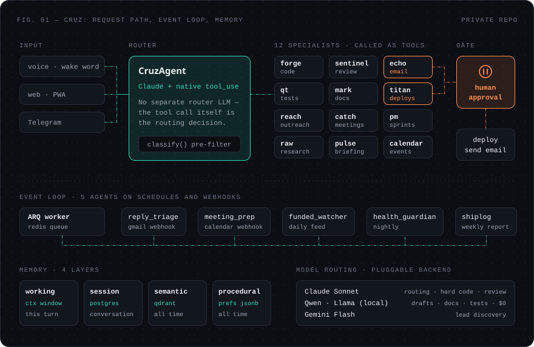
</picture>

- **Routing without a router.** Claude's native tool use picks the specialists and runs them in parallel. A deterministic keyword pre-filter narrows the tool list first, so there is no second LLM call just to decide who works.
- **Approval gates on the irreversible.** Deploys and outgoing email stop for a human. Deploys roll back on their own if they fail.
- **Cost-aware model routing.** Claude Sonnet handles orchestration, hard code and review. Local Qwen and Llama models (through Ollama) handle drafts, docs and tests. Gemini Flash handles lead discovery.
- **Four memory layers**, from the context window to Qdrant vector search over everything it has ever been told.
- **Voice in, voice out.** Wake word, faster-whisper for speech-to-text, a local TTS model for replies.

<p align="center">
  <picture>
    <source media="(prefers-color-scheme: dark)" srcset="assets/cruz-trace-dark.svg">
    <source media="(prefers-color-scheme: light)" srcset="assets/cruz-trace-light.svg">
    
  </picture>
  <picture>
    <source media="(prefers-color-scheme: dark)" srcset="assets/cruz-numbers-dark.svg">
    <source media="(prefers-color-scheme: light)" srcset="assets/cruz-numbers-light.svg">
    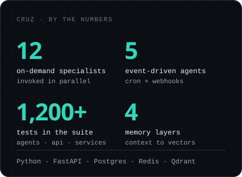
  </picture>
</p>

<br>

## AFK, a permission layer for Claude Code

Claude Code stalls the moment you walk away from a permission prompt. [AFK](https://github.com/drprockz/AFK) learns how you answer those prompts, decides the safe ones for you, and holds the dangerous ones until you're back.

<p align="center">
  <a href="https://github.com/drprockz/AFK">
    <picture>
      <source media="(prefers-color-scheme: dark)" srcset="assets/afk-card-dark.svg">
      <source media="(prefers-color-scheme: light)" srcset="assets/afk-card-light.svg">
      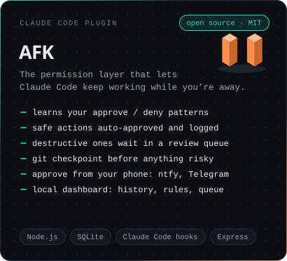
    </picture>
  </a>
  <picture>
    <source media="(prefers-color-scheme: dark)" srcset="assets/afk-chain-dark.svg">
    <source media="(prefers-color-scheme: light)" srcset="assets/afk-chain-light.svg">
    
  </picture>
</p>

```
/plugin marketplace add drprockz/afk-marketplace
/plugin install afk@drprockz
```

<br>

## MCP servers and Claude Code tooling

<p align="center">
  <picture>
    <source media="(prefers-color-scheme: dark)" srcset="assets/mcp-card-dark.svg">
    <source media="(prefers-color-scheme: light)" srcset="assets/mcp-card-light.svg">
    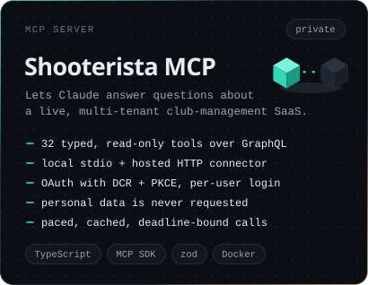
  </picture>
  <a href="https://github.com/drprockz/claude-mods">
    <picture>
      <source media="(prefers-color-scheme: dark)" srcset="assets/dash-card-dark.svg">
      <source media="(prefers-color-scheme: light)" srcset="assets/dash-card-light.svg">
      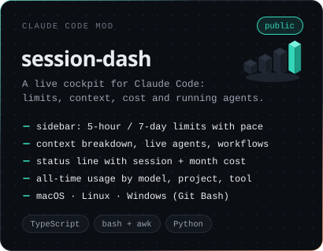
    </picture>
  </a>
</p>

<br>

## Stack

<p align="center">
  <picture>
    <source media="(prefers-color-scheme: dark)" srcset="assets/stack-ai-dark.svg">
    <source media="(prefers-color-scheme: light)" srcset="assets/stack-ai-light.svg">
    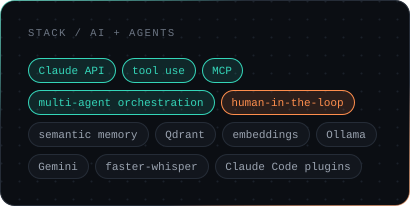
  </picture>
  <picture>
    <source media="(prefers-color-scheme: dark)" srcset="assets/stack-backend-dark.svg">
    <source media="(prefers-color-scheme: light)" srcset="assets/stack-backend-light.svg">
    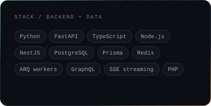
  </picture>
  <picture>
    <source media="(prefers-color-scheme: dark)" srcset="assets/stack-frontend-dark.svg">
    <source media="(prefers-color-scheme: light)" srcset="assets/stack-frontend-light.svg">
    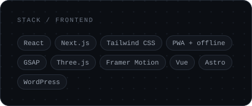
  </picture>
  <picture>
    <source media="(prefers-color-scheme: dark)" srcset="assets/stack-infra-dark.svg">
    <source media="(prefers-color-scheme: light)" srcset="assets/stack-infra-light.svg">
    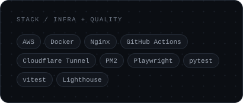
  </picture>
</p>

<br>

## Activity

<picture>
  <source media="(prefers-color-scheme: dark)" srcset="assets/activity-dark.svg">
  <source media="(prefers-color-scheme: light)" srcset="assets/activity-light.svg">
  
</picture>

<br>

## How I work

- **Plan first.** A spec, an architecture doc and a `CLAUDE.md` exist before the first commit.
- **Tests are the contract.** CRUZ ships with 1,200+ of them; an agent's output isn't done until a test says so.
- **Autonomy is earned.** Agents get more room as they prove themselves, and the irreversible always waits for a human.
- **Spend where it matters.** The best model for the hard reasoning, a local one for the routine.

<br>

<p align="center">
  <sub>Every figure on this page is an SVG drawn by <a href="scripts/build.mjs"><code>scripts/build.mjs</code></a>, and the heatmap is redrawn daily by <a href=".github/workflows/activity.yml">a GitHub Action</a>. No third-party widgets.</sub>
</p>
<p align="center">
  <a href="https://stackoverflow.com/users/21765452">Stack Overflow</a> &nbsp;·&nbsp;
  <a href="https://codepen.io/drprockz">CodePen</a> &nbsp;·&nbsp;
  <a href="https://youtube.com/@UCvQTUsqVx7TunNIFsjEZOtQ">YouTube</a>
</p>
